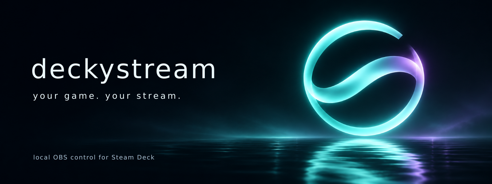

  <picture>
    <source media="(prefers-color-scheme: light)" srcset="branding/aurora/github/readme-header-light.png">
    <source media="(prefers-color-scheme: dark)" srcset="branding/aurora/github/readme-header.png">
    
  </picture>

<h1 align="center">deckystream</h1>

  <strong>Your deck. Your stream.</strong> 
  Control OBS, your microphone and local recordings from Decky's Quick Access menu.

  
  
  
  
  

  <a href="docs/getting-started.md"><strong>Get started →</strong></a> ·
  <a href="docs/README.md">Documentation</a> ·
  <a href="SUPPORT.md">Get help</a> ·
  <a href="CONTRIBUTING.md">Contribute</a>

## Stay in Gaming Mode

- **Go live your way.** Kick, Twitch, YouTube or a custom RTMP(S) destination.
- **Choose what viewers see.** Game-only or entire-screen video, with an intentional between-game screen.
- **Bring your voice.** Microphone selection, mute, gain, meters and optional focused-panel hold-to-talk.
- **Keep the good moments.** Local test clips, recordings, replay and clip export.
- **Know what's happening.** Automatic status, observed-state controls and a copyable diagnostic console.

Broadcasting always needs an explicit **Start**. A local test clip does not go live.
Game-only video does not isolate audio per app.

## Try the preview

You need a **Steam Deck**, **Decky Loader** and a qualified deckystream build.
First-run setup can install the required user-scoped OBS Studio and capture dependencies with your consent.

**[Start with a local clip, then go live →](docs/getting-started.md)**

This is a development preview, with no stable release yet. Use a successful
[candidate build](https://github.com/egohygiene/deckystream/actions/workflows/steam-deck.yml)
and its matching checksums. Real Steam Deck/provider acceptance and first-release
work remain in [finalization #1](https://github.com/egohygiene/deckystream/issues/1).

## Make it yours

| I want to… | Open |
| --- | --- |
| Set up or recover a stream | [Getting started](docs/getting-started.md) · [Steam Deck guide](docs/steam-deck.md) |
| Tune audio, picture or clips | [Microphone](docs/microphone.md) · [Quality](docs/advanced-profiles.md) · [Recording](docs/recording-replay.md) |
| Control OBS from a terminal | [CLI guide](docs/cli-usage.md) · [Configuration](docs/configuration.md) |
| Build, test or contribute | [Contributing](CONTRIBUTING.md) · [Build guide](docs/steam-deck-building.md) |
| Find everything else | [Documentation map](docs/README.md) · [Roadmap](ROADMAP.md) |

## Support development

Free to use. If deckystream helps your stream, you can support its development:

[GitHub Sponsors](https://github.com/sponsors/szmyty) ·
[Buy Me a Coffee](https://www.buymeacoffee.com/szmyty) ·
[Ko-fi](https://ko-fi.com/szmyty) ·
[Open Collective](https://opencollective.com/szmyty) ·
[thanks.dev](https://thanks.dev/u/gh/szmyty)

[Funding configuration](.github/FUNDING.yml) · [Brand kit](branding/aurora/README.md) · [Security](SECURITY.md)

Independent community project. Not endorsed by Valve, Decky or OBS. Original CLI attribution is retained in the <a href="LICENSE">MIT license</a>; packages include dependency notices.
